# OpenHamShack Packet Radio: tester guide

Thank you for trying OpenHamShack Packet Radio. This is a beta, and this
guide is for radio amateurs testing it with a **Yaesu FTX-1, Icom
IC-705 or Icom IC-9700** (or any radio on a sound card interface), or with
an **SDR** as the radio (an ADALM-Pluto or HackRF One, or a receive-only
RTL-SDR or SDRplay). You do not need to be a programmer. Please work through it in order: each step
proves something the next one relies on.

What the app does, in 0.2: APRS (stations heard, a map that works
offline, messages, beacons, an optional digipeater), connected-mode AX.25
chat with stations and nodes, a personal mailbox, IP over AX.25 with
in-app tools, and a receive-only SDR monitor. It sets your radio up for
packet and puts it back afterwards, can use an SDR as the radio, works
with an AKP03E control pad, and updates itself. It runs 1200 baud unless
you choose otherwise; from 0.2.1 a Pluto can also run fast modes (9600 to
153 600 baud), with a Path test and a Link test with a friend (sections
10-12). 0.3.0 adds the link test by callsign, Find my radio and the
control strip (sections 5 and 11), UK nodes, BBSs and conferences (13),
files and pictures (14), mail between stations and Winlink email (15),
APRS extras (16) and the IC-9700 page (17); 0.3.1 how long a file will
take at every speed (14). docs/RELEASE-NOTES.md lists
what is new in each version.

Contents:

1. Install
2. First start: the setup check
3. Try the simulator first
4. Arming transmit, and why it runs out
5. Hooking up the radio
6. Diagnostics: what to send back
7. What is not yet confirmed, and where we need your eyes
8. Known quirks (not bugs)
9. Please do not, yet
10. Path test (0.2.1, Pluto)
11. Link test with another station (0.3.0: by callsign, both ways)
12. Brian and Ray's test, 19/10/2026
13. Nodes, BBSs, conferences and the log (0.3.0)
14. Files and pictures (0.3.0)
15. Mail between stations and Winlink email (0.3.0)
16. APRS: GPS, iGate, weather, telemetry and objects (0.3.0)
17. The IC-9700 page (0.3.0): spectrum, power, satellites, DD

> **Safety first.** The first time you transmit with this app, transmit
> **into a dummy load**, or failing that at the radio's **lowest power**,
> with you sitting at the radio. Do not leave the app armed and unattended
> on a real antenna until you have watched it behave on yours.

## 1. Install

### Linux

Two forms; use whichever suits your system. Both are 64-bit PC (x86-64).

- **Debian or Ubuntu: the .deb** (`OpenHamShack-Packet-Radio-<version>-linux-all.deb`).
  It uses your system's own Python and Qt, so it is small. Install it with

  ```
  sudo apt install ./OpenHamShack-Packet-Radio-<version>-linux-all.deb
  ```

  (`apt` rather than `dpkg -i`, so it fetches PyQt6 and numpy if you do
  not have them). For a real radio it also wants `python3-pyaudio` (sound)
  and `python3-serial` (serial ports); `apt` installs those too unless you
  have turned recommended packages off. Start it from your desktop's menu
  (Ham Radio, or search for "Packet"), or type `shack-packet`.

  To remove it: `sudo apt remove shack-packet`. Your settings stay in
  `~/.config/openhamshack-packet` and your messages and mailbox in
  `~/.local/share/openhamshack-packet`; delete those too for a clean slate.

- **Any other Linux: the AppImage** (`OpenHamShack-Packet-Radio-<version>-linux-x86_64.AppImage`).
  One file with everything inside; it runs on anything from Debian 12 or
  Ubuntu 22.04 onwards. Make it executable and run it:

  ```
  chmod +x OpenHamShack-Packet-Radio-*.AppImage
  ./OpenHamShack-Packet-Radio-*.AppImage
  ```

  If it complains about FUSE, run it with `--appimage-extract-and-run` on
  the end.

Each download comes with a `.sha256` file; `sha256sum -c <file>.sha256`
checks the download arrived intact.

**Serial port permission (Linux).** To use a radio's USB serial port
your user must be in the `dialout` group: `sudo adduser $USER dialout`,
then log out and in again. Without it the app lists the port but cannot
open it.

### Windows

Run `OpenHamShack-Packet-Radio-<version>-windows-x64.exe`. It is signed by
360 Technology. It installs for you alone, with no administrator rights,
into your own Programs folder; the Start menu gets the program and a
"(console)" copy for `--self-test`.

**Windows firewall.** The program receives the IC-9700's network audio,
and listens for OpenHamShack controllers, on your network. Windows asks
the first time a program does that, and if that question is cancelled or
answered for one kind of network only, Windows quietly **blocks** the
program from then on: the radio connects but no audio arrives, with no
message anywhere. So the installer does it properly instead. Its
*Allow the program through Windows Defender Firewall* option (ticked)
removes any rules Windows made for the program, blocking ones included,
and allows it in on **private and public** networks. Changing the firewall
needs an administrator, so **Windows asks once (a UAC prompt) during the
install**: say yes. If you say no, the program installs all the same
without the rules; to add them later, open a Command Prompt **as
administrator** in the install folder
(`%LOCALAPPDATA%\Programs\OpenHamShack\Packet Radio`) and run
`firewall.cmd add`. Uninstalling removes the rules again (it may ask
once more). Updates over the top do not ask again.

To remove the program: Settings › Apps › OpenHamShack Packet Radio ›
Uninstall. Your settings and messages in `%APPDATA%\shack-packet` stay.

### macOS

Open `OpenHamShack-Packet-Radio-<version>-macos-arm64.dmg` and drag the app
to Applications. It is for Apple silicon Macs (M1 and later), signed and
notarised by Apple, so it opens without warnings.

### Updates

From 0.2 the program **updates itself** when it was installed with the
.deb, the Windows installer or the Mac disk image (not the AppImage, and
not a copy run from source). It checks openhamshack.com when it starts
and once a day, sending only its name and version. When an update is
ready, a banner above the pages offers it; nothing is installed without
you pressing **Install**, and never while you are transmitting or
connected to a station (a restart would drop the link). **Help › Check
for updates…** checks now and says what it found. Every update is signed,
and checked before it is installed. Settings › Internet turns the
automatic check off. On Linux the install asks for your password (it runs
`apt` for you); on Windows the program closes, updates and starts again;
on a Mac the new disk image opens for you to drag across.

### Is the program itself sound? (optional)

Before touching a radio you can ask the app to check itself:

```
shack-packet --self-test                       # .deb
./OpenHamShack-Packet-Radio-*.AppImage --self-test
```

It runs a chat, an APRS message and the SDR monitor on its built-in
simulator, with no window and no radio, and ends with `self-test: PASS`.
If it says FAIL, stop and send us what it printed.

## 2. First start: the setup check

The first time the app starts it opens the **setup check**, a short
walk-through. You can run it again at any time from **Station › Setup
check…**, and **Cancel** always puts things back as they were.

1. **Your station.** Callsign (with an SSID if you use one), Maidenhead
   locator, country and licence class. You can listen without any of it;
   to transmit you need a valid callsign and your licence class, because
   the app checks every transmission against the band plan for your
   country and licence.

   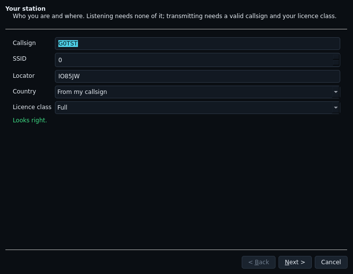

2. **Your radio.** Pick the radio and how the computer reaches it:
   - **Simulator**: a pretend 2 m channel inside the app, with a
     tracker, a station that answers messages and a node that answers
     connections. Nothing is transmitted on any radio. **Choose this first**
     (section 3).
   - **IC-9700 / IC-705**: over LAN or Wi-Fi (the app can look for the
     radio on your network, or you type its address, plus the radio's
     network user name and password), or over a USB cable (the CI-V port
     and the radio's sound devices).
   - **FTX-1**: the CAT port (the *Enhanced* COM port of the two the
     radio shows), how PTT is sent, and the radio's sound devices.
   - **Sound card**: any radio on a sound card interface, with PTT by a
     serial line, by VOX, or none (receive only).
   - **ADALM-Pluto**, **HackRF One** or a **receive-only SDR** (RTL-SDR,
     an rtl_tcp server, SDRplay): an SDR as the station's radio. See
     section 5, "An SDR as the radio", before choosing one to transmit.
   - **None**: receive through the SDR monitor only.

   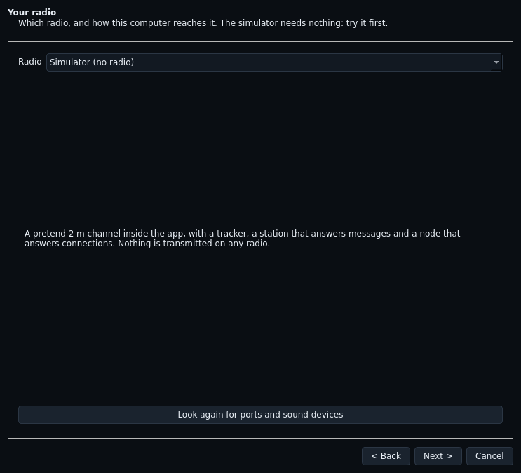

3. **On the radio.** The settings to make on the radio itself for the
   radio and connection you chose, in menu order, and what the app will
   set by itself. Lines marked **\*** have not yet been confirmed on a real
   radio of that model: see section 7.

   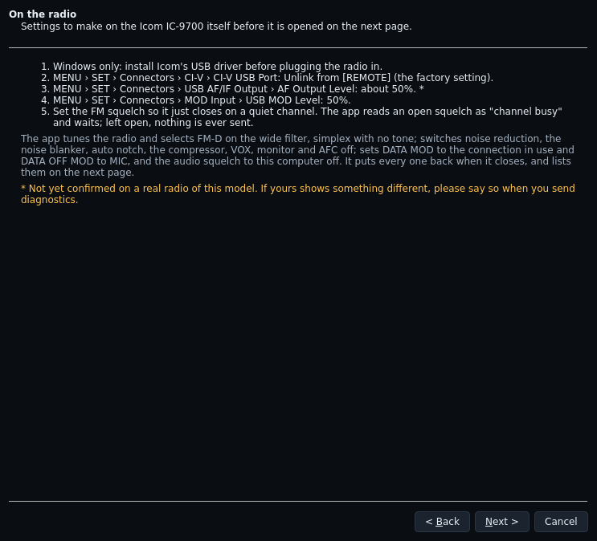

4. **Connect and listen.** The radio is opened **for receive only**, and
   the receive level is shown live. Packet audio should sit in the shaded
   part of the meter; adjust the radio's audio output level until it does.
   (The simulator has no audio, so this page just says so.) Under the
   meter is **what the app changed on the radio** (below), with anything
   you still need to set by hand, and any warning about your set-up. For a
   Pluto, it also says whether its transmitter guard is running.

   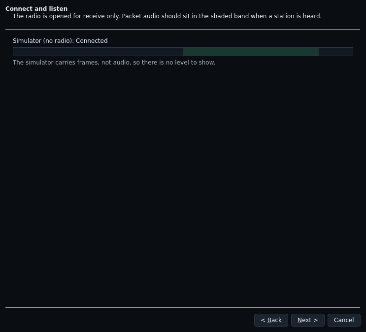

5. **Receive test.** The app listens on your region's APRS frequency
   (144.800 MHz in Europe) and shows what it decodes, live. Nothing heard
   can just mean a quiet channel: APRS stations often beacon only every
   ten minutes or so.

   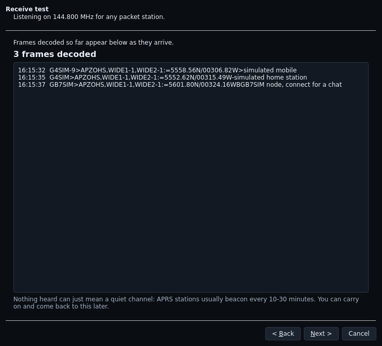

6. **Transmit.** Off unless you tick *Let this computer transmit with my
   callsign*. Even then, nothing is sent until you press **Arm**, and arming
   ends by itself (section 4). You choose how long each arming lasts here
   (15 minutes unless you change it; 1 to 60).

   This page also offers an optional **turnaround measurement**. **It
   transmits**: it keys the radio three times, for under a second each,
   with a tone, to time how quickly the radio comes up to power, and sets
   the packet preamble from that. The button stays greyed out until you
   have ticked both *I am at the radio* and *A dummy load is fitted in
   place of the antenna*. Please only tick the second when it is true.

   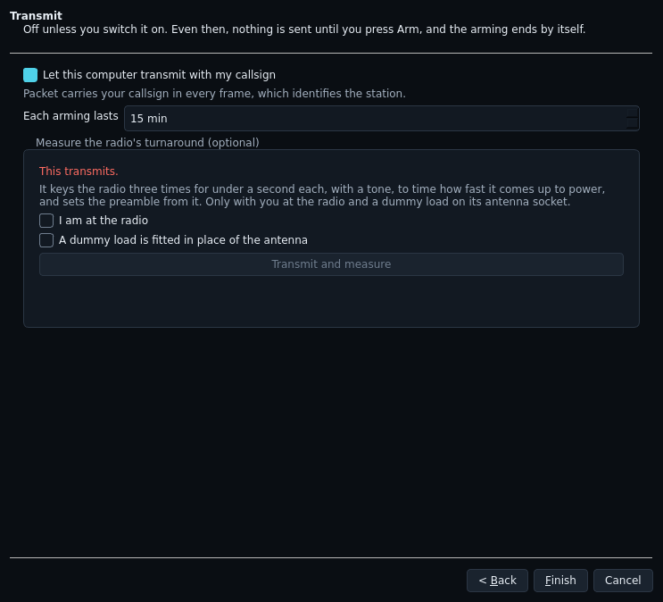

**What opening a radio does to it.** When the app opens a real radio it
writes to it: it tunes the frequency, selects FM data mode (FM-D on the
Icoms, DATA-FM on the FTX-1), sets simplex with no tone (an IC-9700 found
on a repeater shift is put back on it; with split on, it is left alone and
the report asks you to check), switches off the
receive and transmit processing that spoils packet (noise reduction, noise
blanker, auto notch, the compressor or processor, VOX, monitor, and AFC on
the IC-9700), and sets the radio's data audio source (DATA MOD on the
IC-9700, MOD SOURCE on the FTX-1). It reads each setting first and **puts
it back when the app closes the radio**. If the app or the computer
crashes while the radio is open, the app has kept what it found on disk
and puts it back the next time it opens that radio. Station › What the app
changed on the radio… lists every setting, before and after, what it put
back when it closed the radio (and after a crash), what it could not set,
and any warning. **Please include it in a report** if a radio behaves
oddly after the app (it is in the diagnostics zip too). The IC-705's menu
settings (DATA MOD and the like) are the exception: the app does not
change them, and the setup check tells you to set them yourself.

**Noise reduction (NR) must be off for packet.** The app switches it off
for you, but if you ever try packet with another program, do it yourself
first: on 18/10 an IC-9700's NR stopped 2 m packet decoding completely,
because it reshapes the two tones during each packet. The same goes for
the noise blanker and auto notch.

## 3. Try the simulator first

Before connecting a radio, spend a few minutes on the simulator: choose
**Simulator** on the setup check's radio page, put in your callsign, tick
transmit on the last page, and finish. Then:

- **Monitor** shows every frame heard and sent. Within a minute or so you
  should see the simulated tracker, a mobile and a node beaconing.

  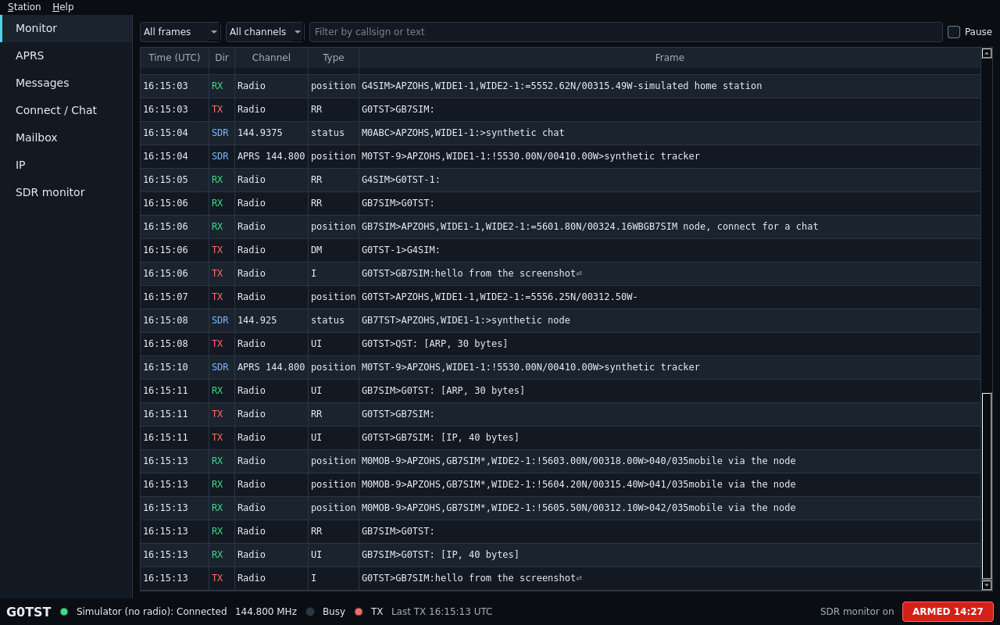

- Press **Arm transmit** at the bottom right (section 4).
- **APRS**: watch stations appear in the list and on the map.
- **Messages**: send a message to the simulated station; it should be
  acknowledged.
- **Connect / Chat**: connect to the simulated node (its callsign is
  shown in its beacon on the Monitor page, "connect for a chat") and type
  a line; it answers.

  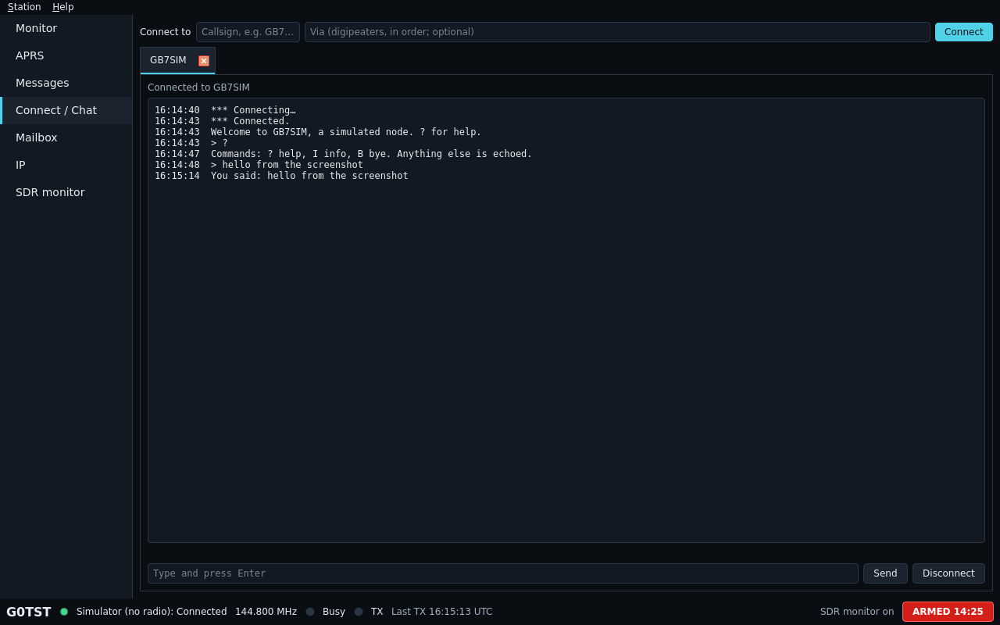

- **Mailbox**: switch your mailbox on, then use the simulator-only
  button that has a simulated friend connect and leave you a message.
- **IP**: ping the simulated node at 44.131.1.2.
- **Notifications** (0.2.3): go to the Monitor page and send the
  simulated station a message from the APRS page's list (double-click
  it). Its answer pops up a notification with a beep, and **Messages**
  turns bold with **(1)** until you open it. Click the notification: the
  window comes forward on Messages. Try the same with the Mailbox
  button and a chat with the node while you look at another page. In
  **Settings › Notifications** choose **Spoken: 'You've got mail!'
  (retro)** (from 0.3.0 a recorded voice, Cori, after a short chime; the
  computer's own voice is the next choice down) and press **Play it**;
  tell us if your computer stays silent
  or beeps instead (and which system you are on). Nothing should pop up
  while you are looking at the page the message goes to.

If all of that works, the app is working on your computer, and anything
that goes wrong later is about the radio connection.

### New in 0.2: the map, the SDR monitor's channels, the control pad

- **The APRS map** now has coastlines, borders and towns built in
  (Natural Earth and GeoNames): it works with no internet at all. Each
  station is drawn with its APRS symbol's shape, an arrow along its course
  if it is moving, and a line home: **solid when it was heard direct,
  dashed through the digipeater** that relayed it (when that digipeater's
  position is known). Click a station (on the map or in the list) to see
  its details under the list: where it is, its locator, how far and which
  way, course and speed, how it was heard, its comment and its last five
  packets. Moving stations leave a track, kept an hour unless you change
  it (Settings › Map). **Settings › Map** can also put OpenStreetMap under
  it; that is off unless you tick it, because it fetches map pictures from
  the internet (only the ones in view, kept a week).

  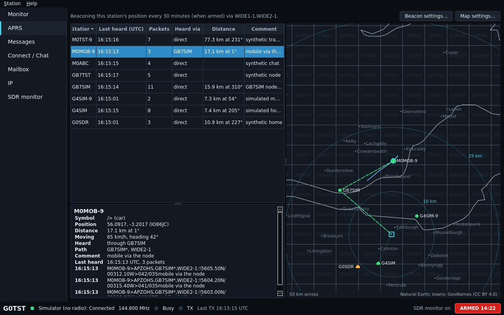

- **Settings › SDR monitor** chooses the band (2 m or 70 cm) and which
  channels the SDR watches, from the band plan, plus any you type. If they
  are spread wider than the SDR can receive at once, it says so and will
  not save until you choose fewer.
- **An Ajazz AKP03E control pad**, if you have one, works as soon as it
  is plugged in (Settings › Control pad shows whether it is found, lets you
  change what each key does, and has a key test). No key transmits by
  itself: **ARM needs two presses of the same key within 3 seconds**, then
  makes the same checks as the Arm button. DISARM and HALT act on the
  first press. BEACON sends your position only while armed, at most once
  a minute. CONNECT calls the station chosen on the APRS page (or typed on
  the Connect page), DISCONNECT ends the chat, and the small keys step
  through the pages. There is no key that just keys the radio: the pad
  can only ask the program, which transmits only while armed. "Back to
  the standard keys" undoes any changes. If you also run OpenHamShack
  QO-100 NB, the two programs hand the pad over between them.

  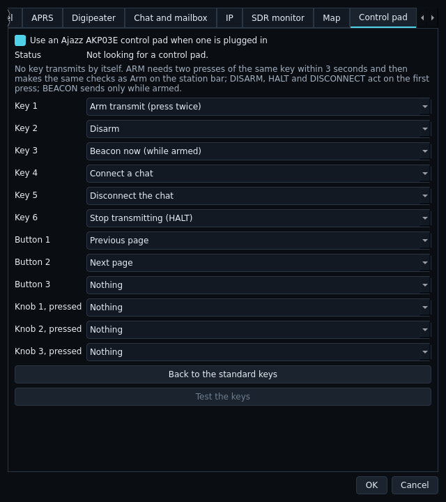

## 4. Arming transmit, and why it runs out

The bar along the bottom of the window shows your callsign, the radio and
its state, the channel, a **Busy** light (the channel is in use), a **TX**
light (we are transmitting now), when we last transmitted, and at the
right the **Arm transmit** button.

- The app only ever transmits while it is **armed**. Press **Arm
  transmit** (or **Station › Arm or disarm transmit**). The button turns
  red and counts down: **ARMED 14:23** means 14 minutes 23 seconds left.
- Press it again to disarm at once.
- When the countdown reaches zero the app **disarms by itself**. Anything
  still waiting to be sent is not sent, and a transmission in progress is
  cut short. Losing the radio connection disarms it too, and every start
  of the app begins disarmed.

**Why it expires.** A packet program can key a radio on its own: replying
to a connection, acknowledging a message, beaconing. Arming that runs out
is a safety timeout, so the app can never keep keying a radio indefinitely
when nobody is watching it. If you are going to be away, let it run out
or disarm it. Re-arm when you are back.

If Arm is refused, the app says why: no valid callsign, transmit not
switched on in the setup check, no radio connected, a radio set up for
receive only, or the band plan does not allow a packet signal on that
frequency for your country and licence class.

## 5. Hooking up the radio

> **The first transmission: dummy load or lowest power, and you at the
> radio.** This is not optional. The developers have used this app on the
> air with an IC-9700 over the network and with a Pluto; every other
> radio, connection and SDR is untested on the air, so your first
> transmit may be the first time this app has keyed your model.

1. Make the settings listed on the setup check's **On the radio** page.
2. Run the setup check with your radio chosen. On **Connect and listen**,
   get the receive level into the shaded band. On **Receive test**, wait
   for some APRS traffic to decode.
3. Fit a dummy load (or set the lowest power). On the **Transmit** page,
   tick transmit, and if you can, run the turnaround measurement.
4. Finish, then press **Arm transmit** and send something small: an APRS
   message to a friend who can reply, or a connection to a local node.
   Watch the radio's TX light and power meter while you do. Disarm
   afterwards.
5. Only when that all looks right, go to your antenna and normal power.

**Squelch matters.** Set the radio's FM squelch so it *just* closes on a
quiet channel. The app treats an open squelch as "channel busy" and waits
politely; with the squelch left open it will never send anything.

### Find my radio (0.3.0)

At the top of the setup check's radio page, and in **Settings › Radio**,
**Find my radio** looks for the radio itself: on the serial ports (it asks
each "who are you?" in Icom's, Yaesu's and, since 0.3.2, Kenwood's own
words, and only reads),
on the network (an Icom's "are you there?"; tick **Also look at every
address on this network** if the radio is not found), for Plutos, and on a
paired controller. Pick the radio from the list and press **Use this
radio**: every field is filled in, including the radio's sound devices
where they can be told apart from others (when not, choose them from the
two lists it shows). It says what to set on the radio when it matters -
the Network User1 name and password (capitals count), CI-V USB baud 115200,
using the IC-9700's LAN to transmit. **Test the connection** reads the
radio's frequency and mode and changes nothing.

Please tell us: what it found, what it missed, and anything it got wrong
(**What was looked at** lists every port and what it said). Close other
programs using the radio first, or its port shows as "in use".

### The control strip (0.3.0)

Under the pages, one line: the **channel** and the **mode** (a Pluto's
fast modes; changing either rebuilds the station and disarms, as Settings
does), and the radio's own controls - **Power**, **RF gain** and
**Squelch** on an Icom, read from the radio and written straight back
when you let go of the slider; a Pluto's **TX gain** (from the next
transmission, never above the band's drive cap) and **RX AGC** or a
manual gain. Live meters: signal, and while transmitting the IC-9700's
**Po, SWR and ALC**; a warning appears if a transmission's SWR is
markedly worse than the last one's. Whatever you change from the strip is
put back when the app closes, like everything else it sets. The control
pad's first two knobs turn **Power** (a Pluto's TX gain) and **Squelch**.

### Turning the radio's own dial (0.3.2)

With a radio the app controls (IC-9700, IC-705, FTX-1, TM-V71), the app
follows the radio: turn the VFO and, once it has sat on a frequency for a
second, that is the station's channel - in the status bar, the strip's
channel box (a preset's name, or **Other frequency** and the frequency),
the transfer estimates and the log. While the dial is moving the status
bar shows "radio retuned; transmit held" and nothing is sent. Once it
settles, anything meant for the old channel is cancelled rather than sent
on the new one - queued frames, connections (dropped without a word on
the air) and APRS messages awaiting an ack - and the status bar says how
many. Armed, the new channel is checked as Arm checks it: allowed, you
stay armed; not allowed, transmit is disarmed with the reason. Turning the
mode knob off FM disarms at once. When the app closes, a frequency (or any
setting) you changed on the radio yourself is left as you set it ("kept"
in Station › What the app changed on the radio); a channel you chose in
the app goes back to where the radio was found.

**Please try, armed, with a second receiver listening:** turn the dial a
step and back quickly (nothing should change); turn it to another packet
channel (the status bar should say "Still armed"); turn it into the
satellite segment, 145.806-146.000 MHz (disarmed); turn the mode to SSB
(disarmed). Your other receiver should hear nothing from this station on
the new frequency until you send something there yourself. After quitting,
check the radio is still where you left it.

### IC-9700: transmit over the network (LAN), not USB

**Use the IC-9700's LAN connection to transmit packet.** On 18/10 an
IC-9700's own USB sound device dropped and repeated tiny pieces of the
transmit audio - about 1,500 parts per million. FT8 does not notice, but
it was enough that no other station could decode its 1200 baud packets
(the same radio over LAN was decoded every time). Not every IC-9700 does
it: an outside tester's 9700 transmitted cleanly over USB. Receiving over
USB is fine. The app warns when a 9700 is set up to transmit over USB; if
yours works over USB, please tell us, with your computer and USB port.

### Kenwood TM-V71 (0.3.2)

The TM-V71 (E or A) needs **two cables**: its **PC port** (the 8-pin
mini-DIN on the back) for control, and a **sound-card interface on its
DATA jack** (the 6-pin mini-DIN beside it) for the packet audio and PTT.
The app never transmits through the PC port: the interface keys the
radio, exactly as a hardware TNC would.

> **Wiring: the TM-V71's DATA jack**
>
> | Pin | Name | What it is |
> |---|---|---|
> | 1 | PKD | audio into the radio (from the interface's output) |
> | 2 | GND | ground |
> | 3 | PKS | PTT: pulled to ground, the radio transmits |
> | 4 | PR9 | the receiver's discriminator, flat (**9600 needs this one**) |
> | 5 | PR1 | receive audio for 1200 |
> | 6 | SQC | squelch output (not used by the app) |
>
> - **Digirig**: its Kenwood/data 6-pin mini-DIN cable on the DATA jack,
>   and in the app PTT **RTS on the interface's serial port** (the
>   Digirig's own port). For 9600 the cable must take receive audio from
>   pin 4 (PR9); check yours.
> - **SignaLink USB**: its TM-V71/6-pin mini-DIN cable or jumper module
>   (TX audio pin 1, PTT pin 3, RX audio pin 4 or 5, ground pin 2), and
>   in the app PTT **the interface's own VOX**; turn its DLY knob as short
>   as it goes.
> - **CM108 board** (AllScan UCI, AIOC, home-built): PTT **a CM108 sound
>   chip's GPIO pin** (3 on most boards). On Linux the chip needs a udev
>   rule giving it to your user, as Dire Wolf's 99-direwolf-cmedia.rules
>   does.
> - **PC port**: Kenwood's PG-5G cable or a compatible USB one. Menu 519
>   (PC PORT BAUDRATE) must match the speed on the app's radio page; 9600
>   is the factory setting.

**On the radio, before opening it:** put one band (A or B) on the band you
will use (2 m or 70 cm) with its BAND key. The app cannot move a band
between VHF and UHF over the PC port, so it uses whichever band is already
there and says so if neither is. Set the squelch to just close.

**What the app does when it opens the radio**, and puts back when it
closes: puts that band in VFO mode (your memory channel is untouched),
tunes it, sets FM, simplex, no tone, sets **menu 517 (EXT. DATA BAND)** to
that band and **menu 518 (EXT. DATA SPEED)** to the packet speed. Both
menu items are traps if you set the radio up by hand: the DATA jack only
works the band 517 names, and 518 also sets how much audio the radio
expects on PKD.

**1200 or 9600**: choose on the radio page (Packet speed) or from the
control strip's mode list. **Transmit level**: at 1200 the radio wants
only about 40 mV peak to peak on PKD, so the interface's output goes near
the bottom of its range; at 9600 about 2 V peak to peak. Start low and
raise it until another station decodes you, aiming for about 3 kHz
deviation; too much at 9600 drives the radio's limiter and nothing
decodes. 9600 needs a 9600 station at the other end, and a 25 kHz
channel.

**The control strip** shows the band's power as **H, M or L** (changed by
name, put back on close), its squelch (read only: it is the radio's knob)
and **Channel busy / clear** in place of a signal meter: the TM-V71 has no
S-meter command over its PC port.

**Find my radio** finds a TM-V71 on its PC port (it asks Kenwood's TY
before ID, because ID would make a packet TNC on another port send a
beacon) and pairs the interface on the same USB hub; choose the PTT and
its port yourself, since nothing on the port says how the interface is
wired.

### An SDR as the radio

The radio page offers three kinds of SDR:

- **ADALM-Pluto** (and clones, PlutoDVB2 and Tezuka firmware): transmit
  and receive. Give its network address (`ip:192.168.2.1` over USB, or
  its address on your network) and its **SSH password** (`analog` unless
  you changed it). Not sure of the address? Press **Find** beside it
  (0.2.3): it looks on USB and the network and offers what it finds. The
  app starts a small **transmitter guard on the
  Pluto itself**, which switches the transmitter off if the program dies,
  freezes or loses the connection. **No guard, no transmit**: if it
  cannot start (no SSH, or a `usb:` address), the Pluto opens
  receive-only and says why on the listening page.
  - **Transmit gain** (from 0.2.2 a list, 0 to -60 dB in 2 dB steps):
    a new Pluto starts at **-30 dB**. Start there into the dummy load and
    raise it a step at a time. With an amplifier's drive cap set for the
    band (*Fast modes and amplifier…*), higher gains are greyed out.
    From 0.2.3 the same list is in **Settings › Channel**, so you can
    change it without going through the setup check.
  - **Check this Pluto** reads its model, firmware and frequency range.
    A Pluto set up as an AD9363 tunes only 325 MHz-3.8 GHz: no 2 m.
    On ADI's firmware, **Enable 70 MHz-6 GHz (AD9364)…** changes that
    setting and restarts the Pluto. **It transmits while it restarts**, so
    it asks you to confirm a dummy load or nothing on the TX port and that
    you are at the Pluto. On other firmware it says how instead.
  - **Crystal correction**: a cheap Pluto's crystal can be 20 ppm out
    (25 kHz on 23 cm). Measure once, either your Pluto's carrier on a
    calibrated receiver or a known signal on the Pluto, and the app keeps
    the correction for that Pluto. Check the Pluto first: *It should be*
    then fills in with the frequency it was checked on, and you type
    what your receiver read into *It was*. The panel scrolls if your
    window is small.
- **HackRF One**: transmit and receive, one at a time. **Transmit is
  experimental in 0.2.0: no HackRF has been heard on the air yet**, so
  start into a dummy load and tell us what you find. Its own +14 dB
  amplifier is off unless you tick it; leave it off and use an amplifier
  after the band filter. A HackRF whose firmware cannot stop on its own
  when the program stops feeding it is refused for transmit.
- **Receive-only SDR**: an RTL-SDR dongle, an rtl_tcp server or an
  SDRplay RSP (with SDRplay's own API installed). The station listens but
  can never arm.

> **An SDR needs a band-pass filter before any antenna.** An SDR's
> harmonics are strong and it has no filter of its own: unfiltered, it
> transmits on several bands at once. **Transmit cannot be set up until
> you tick that a band-pass filter is fitted** between the SDR and
> anything that radiates, or that only a dummy load is connected. Please
> only tick it when it is true. An SDR's output is also tiny (a few
> milliwatts), so expect to need an amplifier for anything beyond the
> shack, again after the filter.

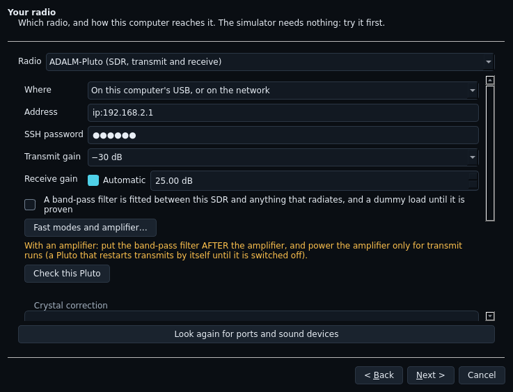

More for a Pluto, from 0.2.1:

- **Where the Pluto is.** On this computer's USB or network, as before,
  or **On the OpenHamShack controller**: a Pluto plugged into the
  controller and shared over the network. The address
  (`pluto://<controller>?iiod=30431&ssh=30422`) fills itself in from the
  paired controller; if you have not paired with it yet, choosing this
  offers to pair there and then (from 0.2.2), and if you do not, the
  address is left as `pluto://host?...` for you to replace `host`. The station will not open it while the controller
  has it reserved or another app is using it. **It needs a good network
  path**: the Pluto's samples are about 10 MB/s each way, so use a wired
  connection; Wi-Fi or a slow internet path drops samples and frames.
  PlutoDVB2's SSH is slow to answer through the controller (up to 25 s
  before the guard is ready).
- **Check this Pluto** also shows its **USB network mode** and the one to
  use on this computer: **ECM on a Mac; RNDIS on Linux and Windows**.
  For a Pluto on the controller it shows the mode the controller uses
  with it, and advises nothing for your computer; a controller's Pluto
  off RNDIS is offered the switch, since the controller runs Linux.
  NCM stalls receive on Linux and the Pluto's own watchdog then restarts
  it. If yours is wrong, **Switch to …** changes it and restarts the
  Pluto, with the same two confirmations as the AD9364 change (**a
  restarting Pluto transmits** on 2450 MHz until the app quiets it: dummy
  load or nothing on TX, and you at the Pluto). It reports how many
  seconds the transmitter took to read back quiet.
- **Windows: a Pluto with no network** usually means ADI's USB driver is
  missing. The check links to ADI's *PlutoSDR-M2k* driver installer
  (github.com/analogdevicesinc/plutosdr-m2k-drivers-win/releases); install
  it, unplug and replug the Pluto, and check again.

### Fast modes on a Pluto (0.2.1)

Settings › Fast modes (or the button on the setup check's Pluto page).
These apply to a Pluto only; every other radio stays at 1200 baud.

- **Mode**: AFSK 1200 (the default, what every packet station hears),
  G3RUH 9600 / 19 200 / 38 400 (any G3RUH station), and between two
  OpenHamShack stations only GFSK 76 800 / 153 600 and 4-FSK 38 400 /
  76 800.
- **Link adaptation**: **both stations** must turn it on. Each direction
  then runs at the fastest mode its receiver can decode, between the
  *fastest* and *slowest* modes you choose (defaults 4-FSK 76 800 and
  G3RUH 9600). Acknowledgements always go at the slowest.
- **Window** (up to 63), **packet length** (up to 2048 bytes), **selective
  reject**, **TXDELAY** and **turnaround**. The defaults suit two Plutos.
- **The band plan.** A mode wider than 25 kHz may only go in a
  high-speed data segment: on 23 cm **1299.000-1299.750 MHz** (and
  1241.000-1241.750) in 150 kHz channels centred on 1299.075, .225, .375,
  **.525** and .675; GFSK 153 600 (166 kHz) only on 13 cm, 2311-2315 MHz.
  **1298.500 is a 20 kHz channel**: no wide mode there. The settings say
  where your mode sits, where the Pluto's LO leakage and image land, and
  offer **1299.525 MHz**; Arm is refused out of plan. G3RUH 9600 (10 kHz)
  fits an ordinary 25 kHz channel, e.g. 432.650 on 70 cm.
- **PTT output and amplifier** (for an amplifier after the Pluto):
  - **PTT output** keys the amplifier's relay: GPO0-3 on ADI firmware,
    or *firmware* on PlutoDVB2 and Tezuka (their own GPO0 follows the
    transmitter). Run Check this Pluto first: it decides what is offered.
    Which pins reach a connector depends on the board: check with a meter
    before connecting a relay.
  - **Drive cap**, per band: the most transmit gain the Pluto may use
    with that band's amplifier. **Find the drive level…** steps the gain
    up from -30 dB a couple of dB at a time: arm, press **Send a burst**,
    read your power meter, press **Good: next step**; stop at the power
    you want or where the output stops rising, and **Stop and save the
    last good step** keeps it as the cap. Into a dummy load first.
  - **Put the band-pass filter AFTER the amplifier.**
  - **Power the amplifier only for transmit runs.** A Pluto that restarts
    transmits on 2450 MHz at about -10 dB until it is quieted; an
    amplifier left on would amplify that.

## 6. Diagnostics: what to send back

When something goes wrong, or when it all works and you want to say so,
either:

- **Help › Send diagnostics…** sends them to OpenHamShack at once and
  shows a code such as `SHACK-7KQ2`. Email that code to the person who
  invited you to the beta (Brian Henderson, GM4BRI), with a few words
  about what you were doing, which radio and connection, and what you
  expected to happen. If it cannot send (no internet, or the site not
  yet ready), save them instead:
- **Help › Save diagnostics…** saves a zip file wherever you like (its
  name starts `shack-packet-diagnostics-` with the date and time). Email
  the zip with the same few words.

**Sending them by themselves (opt-in).** Settings › Internet has *Send
diagnostics to OpenHamShack by themselves*, **off unless you turn it on**;
the page says exactly what is sent. When on, the program sends the same
texts as Send diagnostics (never the picture of the window) shortly after
something goes wrong - the radio not confirming it stopped transmitting,
a watchdog unkey, the radio lost, a crash - and at most once a day
otherwise. It never sends while transmitting or on a metered (mobile)
connection, and a failure never interrupts you.

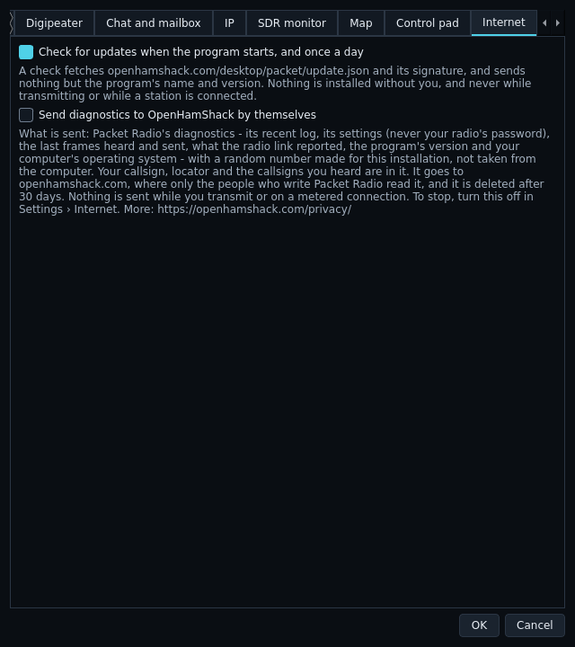

The zip holds the app and library versions, your settings, the recent
program log, the last frames heard and sent, the transmit timings and what
the radio link reported, and a picture of the window. It never contains
your radio's network password or a Pluto's SSH password, and your
computer's name and your home folder's name are left out. Apart from the
update check (section 1), and diagnostics only if you turn that on, the
app sends nothing anywhere by itself.

## 7. What is not yet confirmed, and where we need your eyes

The **On the radio** steps marked **\*** come from the radio's manuals or
from similar models, not from a real radio of that model. If your radio's
menu says something different, do what your radio says and **tell us** in
your diagnostics email. That is one of the most useful things a tester
can report.

Unconfirmed in this beta:

- **IC-705**: everything on its page. Its DATA MOD setting (USB or WLAN),
  its Wi-Fi network login (WLAN Set › Remote Settings), whether its CI-V
  USB Port item matches the IC-9700's, and joining it to your network.
- **IC-9700**: the network items (Network Control, Network User1 ID and
  Password) and the USB AF Output Level.
- **FTX-1**: the USB OUT LEVEL and USB MOD GAIN items.
- **Kenwood TM-V71 (0.3.2)**: everything. The app was written from
  Kenwood's manuals and the command lists others have worked out (hamlib,
  CHIRP), and tested against a pretend TM-V71 only. Please tell us:
  whether it is found and opens; what menus 517 and 518 show while the
  app runs and after it closes; whether the band, frequency and memory
  channel come back; whether 1200 and 9600 are decoded by another
  station, and at what interface output level; which interface and cable
  you used.
- **Following the radio's dial (0.3.2)** on a real radio: tested against
  pretend IC-9700 (turned by its CI-V Transceive message), FTX-1 and
  TM-V71 only. Please tell us if the app follows your dial within a
  second or two, and whether it follows when the radio's CI-V Transceive
  is off (it should, a little slower). On a TM-V71 the app reads the
  band's VFO, so switching the data band to a memory channel holds
  transmit (the status bar says MEMORY) until it is back in VFO.
- **Notifications (0.2.3)** on each system: that the pop-up appears and
  clicking it brings the window forward, and what the spoken sound
  sounds like (it uses your computer's own voice). Tested so far with
  stand-ins only, not on a real Windows, Mac or Linux desktop.
- **Find (0.2.3)** for a Pluto on Windows and macOS: tested so far
  without a real Pluto.
- **Everything new in 0.3.0** (sections 5, 11 and 13-17) was tested on
  the simulator and against pretend radios, nodes, BBSs, gateways, GPS
  units and weather stations only. In particular: Find my radio and the
  control strip's meters on a real radio, the link test by callsign
  between two real stations, a real UK node, BBS or conference, YAPP and
  7PLUS with other packet programs, a real Winlink gateway, APRS-IS,
  the IC-9700's scope, satellite mode during a real ISS pass, and 23 cm
  DD. Whatever a real one does differently is exactly what we need to
  hear.

The IC-9700's own CI-V control is also still to be checked against a real
radio, including that its DATA MOD setting is put back correctly when the
app closes: worth a glance at the radio's menu after you quit.

## 8. Known quirks (not bugs)

- **"The link was reset after an unexpected answer", then a second
  welcome message.** On a busy channel two stations can try to start a
  connection at the same moment. AX.25 says both ends must then reset the
  link and start again, dropping anything queued. You see the node's
  greeting twice. That is the protocol working as designed; type your line
  again.
- **IP over AX.25 works inside the app only.** The IP page's ping and
  tools work; other programs on your computer (a web browser, ssh) cannot
  use the packet link in this release. A system-wide network interface
  comes in release 2.
- **The APRS identifier APZOHS is provisional.** APRS software identifies
  itself in each packet's destination field. OpenHamShack has applied for
  its own registered identifier; until it is granted, the app uses the
  experimental APZOHS. Expect it to change in a later release.

## 9. Please do not, yet

- Do not leave it armed and unattended on a real antenna.
- Do not run the digipeater on a busy APRS frequency unless your area
  needs one and you have permission or are the local coordinator.
- Do not use another program on the same radio at the same time (RS-BA1,
  wfview, WSJT-X or another packet program): the radio serves one at a time.

## 10. Path test (0.2.1, Pluto)

Which modes does the path between two stations carry? One station sends,
the other listens, one direction at a time.

> **Antenna on the Pluto's TX port to send, on its RX port to receive.
> Never join the two ports with a plain tee**: it puts the transmitter
> straight into the receiver. With one antenna and no transmit/receive
> switch, move the cable by hand between runs.

Both stations: a Pluto as the radio, **link adaptation on** in Settings ›
Fast modes (the page tests the modes on that ladder, and says what to set
if it is off), the same frequency (1299.525 MHz for the wide modes), and
the same modes ticked and frames per mode (default 50).

- **Receiver** (antenna on RX): choose *Receives*, **Start receiving**. A
  table fills in, fastest mode first: heard and missing, % through, level
  (C/N0, dB-Hz) and SNR, offset (not measured yet: shows "-") and bad
  checksums (noise counts too, so compare modes, not numbers). When the
  sender has finished, **Stop**. The line under the table gives the best
  mode this way (90 % or more through). **Save report…** or **Copy
  report** and send it to the other station; it is also in Help › Save
  diagnostics. **Use for adaptation** makes this station's first request
  for that direction start at that mode.
- **Sender** (antenna on TX): choose *Sends*, **arm**, **Start sending**.
  Modes not allowed at this frequency are greyed with the reason. Stop,
  Disarm, HALT or the arming running out stop it at once.

Then move the cables at both ends, swap roles, and test the other
direction.

## 11. Link test with another station (0.3.0: by callsign, both ways)

A connected-mode transfer between two stations, one direction at a time,
**both directions in one go**. The station receiving never transmits:
its acknowledgements go back **over the internet**, through
openhamshack.com, and a banner says so the whole time. Any radio: an
IC-9700, a Pluto, the simulator for practice.

On the **Link test** page, at **both** stations:

1. Type the **other station's callsign** (with its SSID if it uses one)
   and press **Start**. The two find each other as soon as both have
   started with each other's callsign; the page says "Waiting for…" until
   then. Leave **Test size** at 5 KB (about a minute each way at 1200
   baud) unless you are after something particular.
2. The station whose callsign comes **first alphabetically** sends first.
   When it is your turn to send the page says **Your turn to send: arm
   transmit** - press **Arm transmit** as usual. The run never arms for
   you, and the receiving station cannot arm until its half is over.
3. **A Pluto** (one antenna, separate TX and RX ports): before each half
   the page asks you to put the antenna on the right port and press
   **Done**; the other station waits for you. A radio with one antenna
   socket needs nothing.
4. The **Results** table fills in both directions side by side, from both
   stations' words: bytes acknowledged, time, speed, and whether the data
   arrived intact (CRC OK); then a summary. **Save report…** writes it
   all to a text file (with the full record at the end) - please send it
   to us. **Stop** at either station ends the run at both.

If openhamshack.com stops answering for about 8 seconds, the link drops at
once and nothing more is sent; the sender is disarmed. Changes you make on
the control strip during a run (power, gain, squelch, channel) are listed
in the report.

**Advanced** keeps the Pluto's mode and window (as before) and the 0.2.1
relay on an OpenHamShack controller, for a test on a tailnet: tick **Use a
relay on an OpenHamShack controller** and give its address.

## 12. Brian and Ray's test, 19/10/2026

GM4BRI (Mac/Linux) and GM0OTB (Windows), 23.5 km, a Pluto each, one
antenna each, no T/R relay. Brian keys only with Brian present; transmit
only on the agreed frequency.

**Before:**

- Both on 0.2.1 (Help › Check for updates; 0.2.0 offers it).
- Check this Pluto on each: USB mode **ECM on the Mac, RNDIS on Linux and
  Windows** (switch it with the Pluto's TX on a dummy load or open, not
  the antenna); note the firmware (PTT output).
- Settings › Fast modes on both: **link adaptation on**, fastest 4-FSK
  76 800, slowest G3RUH 9600, window 63, packet length 512, selective
  reject on; frequency **1299.525 MHz**. If there is an amplifier: drive
  cap found into a dummy load first, filter after the amplifier, amplifier
  powered only for the runs.
- **Ray's PC cannot reach the relay yet**: it needs a tailnet rule on
  Brian's side admitting Ray's machine to the controller's port 30480.
  Until Brian adds it, do the path tests (they need no relay) and leave
  the link test.

**1. Path test, Brian to Ray.** Brian's antenna on TX, Ray's on RX. Ray
*Receives* → Start receiving; Brian *Sends*, arms, Start sending (50
frames a mode, about a minute a mode). Ray stops when it finishes, saves
the report, and presses **Use for adaptation**.

**2. Path test, Ray to Brian.** Move both cables. Same again, roles
swapped; Brian saves his report and presses Use for adaptation.

**3. Link test, Brian to Ray** (once Ray reaches the relay). Brian's
antenna on TX, Ray's on RX. Link test page on both: relay
`ohs-box:30480`, session **bri-ray-1**; Ray *RF receiver*, other
station Brian's call; Brian *RF sender*, other station Ray's call. Ray
Joins first, then Brian Joins, arms, **Connect and send**. Note the speed
and CRC OK. Both Leave.

**4. Link test, Ray to Brian.** Move both cables. Session **bri-ray-2**,
roles swapped: Brian Joins first as RF receiver; Ray Joins, arms,
Connect and send.

**After:** Help › Save diagnostics on both (it carries the path-test
report and the link-test log) and send the zips to Brian.

Thank you. Every report, including "it just worked", helps.

## 13. Nodes, BBSs, conferences and the log (0.3.0)

Everything here works on the simulator first: its node **GB7SIM** now
behaves like a GB7 BPQ node, with a BBS, a chat conference and a second
pretend node behind it (GB7SJ). Arm transmit for each step that
connects.

- **Nodes page.** Within half a minute of starting, GB7SIM's NODES
  broadcast fills the list: GB7SIM itself (heard directly, at the top)
  and the nodes it advertises (SJ, ABDN, BRSTL) "reached via" GB7SIM.
  Double-click **GB7SJ**: a session opens on GB7SIM and types **C SJ**
  for you; GB7SJ greets you. Type **N** there and a node only GB7SJ
  knows (ZZSIM) joins the Nodes list.
- **A BBS, with the helpers.** Connect to GB7SIM and type **BBS** (or
  use the **BBS** button on the right). The right-hand side becomes the
  mail helper. **List** types L; after ten messages the BBS asks
  "<A>bort, <CR> Continue..>" and **Continue** / **Stop listing** appear
  under the terminal. Pick a message and **Read**; **New…** leaves one
  (the app answers the BBS's title and text questions for you, visibly);
  **Kill** deletes one of yours. Everything the buttons do is typed in
  the terminal where you can see it, and you can still type anything
  yourself.
- **Connect scripts.** Connect / Chat › **Scripts › Edit scripts…**,
  **New**, and keep the example (connect GB7SIM, wait for its greeting,
  send BBS). Save, then run it from the Scripts menu disarmed: it waits,
  and sends nothing until you arm. A wait that never comes true stops the
  script with a note in the session.
- **A node conference.** In a GB7SIM session press **Join conference**
  (it types CHAT). The right-hand side lists who is in (G4SIM, G8SIM);
  say something and G4SIM answers. **Leave** types /q.
- **Host a room.** Connect / Chat › **Room**, give it a name and topic,
  **Open the room**. It says whether stations can join: only while
  transmit is armed. On the air, ask a friend to connect to your call
  with SSID 4 (for example GM4BRI-4) from any packet program: they get a
  welcome, everyone sees "*** CALL joined", and /who, /me, /topic and
  /quit work. Close the room when finished. (The simulator's stations do
  not call rooms; this one needs a friend on the air.)
- **Unread tabs.** With two sessions open, a line arriving in the one
  behind shows a count in its tab until you click it.
- **Callsign lookup.** Make a free account at hamqth.com, then Station ›
  **Callsign lookup…** (or the Log page's button). Hover a callsign in
  the Monitor's frame column, a chat's header, the Nodes page or the
  room: the first hover says "looking up", the next shows name, QTH,
  locator, distance and bearing. Tell us if a wrong password is not
  reported clearly.
- **The log.** Tick **BBS and node sessions** on the Log page, connect to
  GB7SIM, and disconnect: the session appears in the log. **Log contact**
  in any session logs it by hand. Filter (try "2m" or a call) and
  **Export ADIF…**; import the file into your usual logger and tell us
  what it makes of it (mode PKT, the speed in the comment, no RST).

**On the air, please tell us** how the helpers read your local GB7
node and BBS (a message list that comes out empty or wrong, a paging
question the buttons did not appear for, a conference whose member list
stays empty), with Help › Save diagnostics and, if you can, a **Capture**
of the session.

## 14. Files and pictures (0.3.0)

Try it on the simulator first: its file station **G4SIMF** behaves like
another OpenHamShack station. Arm transmit, then **Connect / Chat** →
connect to **G4SIMF**.

- **Send a picture.** Drag a photo from your file manager onto the
  G4SIMF tab (anywhere on the page will do), or press **Send file…**
  at the top right of the tabs. The dialog lists Original, Large,
  Medium, Small and Tiny with the picture's size in pixels, how many KB
  it would be, and about how long it takes at your current mode. On the
  simulator's 1200 baud choose **Tiny** or **Small** (Medium is a few
  minutes). **Send**. Watch the **Files** page: the row goes from
  "Waiting for an answer" to "Sending" with a percentage and a speed, then
  "Done", and G4SIMF says in the chat that it received and checked it.
- **Receive one.** Type **PIC** in the G4SIMF tab. A question pops up:
  who it is from, the file's name, size and type, and the folder it will
  go in. **Accept**. When it is done, select it on the Files page: you
  see a thumbnail and where it was saved. **Show folder** opens the
  folder; the app itself never opens a received file. Try **Decline**
  with another **PIC**: nothing is written.
- **How long will it take? (0.3.1)** The Send dialog has a table:
  every mode from AFSK 1200 to 4-FSK 76 800 and 23 cm DD, each with
  "about …" on a good link and with retries. Your station's mode is
  highlighted; the modes your radio cannot send are greyed and say why.
  Change the picture size or **Send by** and the table changes: a
  smaller picture, or a text file that compresses well, is quicker.
  Select a file on the Files page for the same table, how long it took,
  or (while it goes) how long is left. After a transfer or a link test
  with a station, the row for that mode says "measured with <call>" and
  uses what the path really did. **Please tell us** how the estimate
  compared with the real time on the air, with the mode and the size.
- **YAPP.** Type **YAPP** for a text file sent by YAPP (what other packet
  programs use). In the Send dialog, **Send by → YAPP** sends one that
  way.
- **Resume.** Send a bigger file (a Medium picture) and, half way, press
  **Disconnect** on the tab. The row says "Interrupted (can resume)".
  Connect to G4SIMF again: it carries on from where it stopped on its
  own, or select the row and press **Resume**. The arrival is checked
  over the whole file.
- **Settings** are on the Files page: the folder, "Decline offers over
  … MB", "Resume a file I already accepted without asking again",
  "Compress for OpenHamShack stations", and which protocol Send uses
  first.
- **7PLUS.** On the Files page, **Encode…** a file into parts (choose
  the lines per part first) and **Decode files…** them again, or paste
  the text of saved BBS messages with **Decode pasted text…**. If parts
  are missing it says which.

**On the air, with a friend who also runs 0.3.0**: connect to each other
as for a chat and send a small picture first (Tiny at 1200 baud is under
a minute). On a Pluto fast mode try a Medium or Large picture. Please
tell us the size, the mode, how long it took (the Files page shows the
speed) and whether the picture looked right. If the link drops part way,
does it resume when you connect again?

**With other packet software** (WinPack, FBB, a BPQ terminal, anything
that offers YAPP): send a small file by YAPP each way. This has not been
tried against other programs yet: please say which program and version,
and whether it worked, and send diagnostics if not.

**7PLUS through a BBS**: encode a small file, post the parts as messages
to a BBS, read them back (or capture the session), and decode.

## 15. Mail between stations and Winlink email (0.3.0)

Everything here can be tried on the simulator first. Mail only goes while
transmit is armed; written mail waits in the outbox until it is.

**Packet mail on the simulator.**

1. Mailbox › **Packet mail** › **New…**: To `M0SIM`, a subject and a few
   lines; **Queue to send**. It shows under *Outbox and sent* as
   *Queued*.
2. Arm transmit. Within about half a minute it should change to
   *Sending to M0SIM-1*, then *Delivered via M0SIM-1*. While you look at
   another page you get a notification "Mail delivered to M0SIM".
3. Settings › **Mail**: Home BBS `GB7SBB-1`, OK. Write to `G4ABC` (a
   station that does not exist): it is tried at G4ABC-1 (no answer),
   then delivered via GB7SBB-1, the BBS keeping it for G4ABC.
4. **Collect now**: your station connects to GB7SBB-1 and brings back
   anything held there for you (nothing, the first time).

**Winlink on the simulator.**

1. Settings › Mail: Winlink password anything (the pretend gateway
   takes any), Gateways `GB7RMS-10`, OK.
2. Mailbox › **Winlink email** › **New…**: To an email address of
   yours, attach a small file. It sits in the Outbox.
3. Arm transmit, choose GB7RMS-10 and **Connect to gateway**. It should
   end "sent 1, received 1"; the Inbox has a welcome email from the
   gateway, your message has moved to Sent. Nothing leaves your computer.

**On the air (only with Brian's go-ahead, and a friend).**

- Two OpenHamShack stations: each switches its mailbox on (Mailbox ›
  Accept messages left for me) and writes to the other's callsign. Tell
  us how long delivery took and what the Outbox said at each step.
- A real BBS (GB7 BPQMail) as home BBS: write to yourself
  `YOURCALL@GB7XXX` from another station, then Collect now. Tell us what
  the BBS said if it refuses (Help › Save diagnostics has the session).
- **Winlink with a real RMS gateway** (needs your Winlink account and
  password): send one short email to yourself and collect the reply. This
  has never been tried against a real gateway - a login refused, a
  protocol error, or a message that arrives garbled are exactly what we
  need to hear about.

## 16. APRS: GPS, iGate, weather, telemetry and objects (0.3.0)

Each of these is off until you switch it on; everything that transmits
waits for transmit to be armed.

- **A typed-in position**: Settings › GPS › *A position I type in*,
  `55.95, -3.19`. The APRS page's map moves your square there; with
  Beacon on, the beacon carries that position.
- **A GPS**: a USB GPS (*A GPS on a serial port*: /dev/ttyACM0, COM5...,
  usually 4800 or 9600) or gpsd. The APRS page's top line says "GPS:"
  and the position, or why it cannot reach it. Drive or walk with
  SmartBeaconing on and tell us how often it beaconed.
- **iGate** (receive only first): Settings › iGate › *Pass what I hear to
  APRS-IS*. The APRS page says "iGate: connected, N gated". Check your
  call on aprs.fi as the iGate for stations you hear. Only then try *Also
  send messages from APRS-IS*, and tell us if anything went out you did
  not expect.
- **Weather**: a Peet ULTIMETER or Davis Vantage on a serial port, or a
  file (JSON like `{"temp_c": 11.5, "humidity": 70, "wind_mph": 8}`, or a
  CSV with a header row). The APRS page says "Weather: N readings."; the
  first report goes a minute or so after arming, then every 10 minutes.
  The Peet and Davis readers were written from the makers' documents and
  have never met a real station: tell us if numbers look wrong.
- **Telemetry**: Settings › Weather › *Send telemetry*. aprs.fi's
  telemetry page for your call should show the four counts.
- **Objects**: right-click the APRS map › name it (up to 9 characters),
  a symbol (`/r` repeater, `/;` event...), a comment. It shows on the map
  in the accent colour and goes out every 30 minutes while armed. **My
  objects…** › Kill sends it three times as killed; check it vanishes on
  aprs.fi.

## 17. The IC-9700 page (0.3.0): spectrum, power, satellites, DD

The page is **IC-9700** in the list on the left. It needs an IC-9700 as the
station's radio, connected over the network. None of this has been on the
air yet: please tell us what you see.

**Spectrum.** Opens the radio's scope (the radio's own display carries on
as normal). Set the span (± kHz), reference and speed at the top. Packet
channels are dashed lines with their names; a channel that looks busy is
shaded red - if one is shaded while you hear nothing, or not while you
hear packet, say so and send diagnostics: the threshold is a guess until
measured. **Click a channel to tune to it**; transmit is disarmed when the
radio retunes, so arm again. Leave the page and the radio stops sending
its scope a few seconds later.

**Power.** Tick **Adapt transmit power** to try it; set the cap (it never
goes above), the floor and the step. During a connected session the list
shows each change and why (frames repeated: up; working: down). If you
turn the power knob or change it in the app, adaptation stops for that
session. It is not used while Settings has the real-radio test's
minimum-power step on.

**Satellites.** Press **Update orbital elements** (needs the internet,
once in a while; passes are worked out offline after that). Choose the
satellite, tick **Track**, and check the passes list against another
prediction (Heavens-Above, Gpredict). For the ISS press **Set the station
up for this satellite**: the channel becomes 145.825 MHz and the APRS path
ARISS. Arm is refused until the ISS is above the elevation you set, and
transmit is disarmed when it sets. With **Doppler** ticked the IC-9700's
receive and transmit frequencies follow the pass (watch them move on the
radio) and go back afterwards. **Back to my channel** restores what you
had. Only transmit to the ISS on a pass you can hear.

**23 cm DD (experimental, please do not, yet, unless arranged with
Brian).** Read docs/DD.md first: in DD the radio transmits whatever
reaches its network port, so it needs its own cable or network port, not
your home network. **Use DD** puts the radio in DD on the chosen channel;
then press **TRANSMIT** on the radio as the page asks, and press it again
before **Stop DD**, which puts the radio back as it was.

